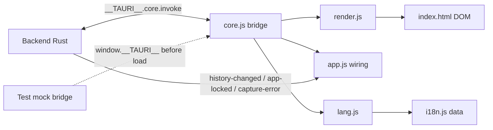

# DESIGN.md — Ky desktop UI

Status: v2 (2026-11-12) · Owner: `desktop/ui/`
Source of truth: this file + the shipped assets in `desktop/ui/`.

## 1. Scope

Ky desktop is a lightweight, local-only clipboard history + named-snippet + vault
surface for the **kyvault** CLI. It is **not** the website (`docs/`). The desktop
app is a static vanilla HTML/CSS/JS bundle served inside **Tauri 2**. No
bundler, no build step, no framework, no network calls.

Everything it renders comes from a single backend snapshot. The frontend never
holds plaintext secrets, never persists secret data, and never asks for or
reinvents redaction — it only displays what the backend returns.

## 2. Constraints (binding)

No dependencies / no build. Static files only.
No inline JS or CSS, no `unsafe-html`. Handlers are attached in code; all text
is inserted with `textContent`, never `innerHTML`.
No network. `localStorage` holds **only** `ky.lang` and `ky.toolbarCollapsed` —
never history, secrets, or clipboard content.

## 3. Architecture



### Files (all < 400 lines)

| File | Role | Lines |
|---|---|---|
| `desktop/ui/index.html` | Page shell + all dialogs, i18n markers | 85 |
| `desktop/ui/styles.css` | Tokens, vibrancy layers, motion | 278 |
| `desktop/ui/core.js` | Bridge, state, DOM helpers, `__kyDiag` | 129 |
| `desktop/ui/i18n.js` | **Data only** — zh-CN + en dictionaries | 330 |
| `desktop/ui/lang.js` | i18n glue (apply / sync / persist) | 76 |
| `desktop/ui/render.js` | List + preview rendering | 297 |
| `desktop/ui/app.js` | Wiring, commands, dialogs, shortcuts | 295 |
| `desktop/ui/logo.png` | Brand mark (parent-provided) | — |

`app.js` uses **top-level await**; `index.html` loads it as
`<script type="module">`. This keeps `window.__TAURI__` (mocked before load in
tests) authoritative when the `desktop` flag is computed.

## 4. Theme + vibrancy tokens

Brand is carried from `docs/styles.css`: **mint `#66f0b5`** on **charcoal
`#080d10`** (dark) and a soft mint/charcoal tint in light. The desktop app uses
the same hue, mapped to a compact system-aware scale.

```css
/* dark */
--bg:#0d1410; --sidebar:#121b15; --surface:#182219;
--text:#e3ece6; --muted:#a0b0a6; --line:#2b3931;
--accent:#66f0b5; --accent-text:#0a2e1f;

/* light */
--bg:#eef4ef; --sidebar:#e6efe8; --surface:#f6faf7;
--text:#1d3027; --muted:#617069; --line:#d4e0d8;
--accent:#086744; --accent-text:#ffffff;
```

Switching is pure CSS via `prefers-color-scheme:` plus
`<meta name="color-scheme" content="light dark">`, so native controls
(scrollbars, dialogs, checkboxes) follow the system theme with no JS.

### Vibrancy / frosted glass — fallback matrix

The window is transparent with `titleBarStyle: Overlay` + `hiddenTitle` +
`windowEffects: underWindowBackground`. The CSS layers green-tinted glass over
whatever the OS paints behind the window.

| Environment | `--body-opaque` | Panels | Result |
|---|---|---|---|
| macOS, `backdrop-filter` supported | `rgba(20,27,24,.72)` / `rgba(238,244,239,.78)` | translucent + `blur(28px) saturate(1.7)` | frosted green glass over the wallpaper |
| Any WebView without `backdrop-filter` | opaque `#141b18` / `#eef4ef` | opaque `var(--sidebar)` / `var(--surface)` | flat, fully legible, **never translucent-without-blur** |
| Reduced transparency (OS setting) | OS paints the opaque window background | same as above | legible |

Rules enforced in `styles.css`:
1. Panels are **opaque by default**; the translucent rule lives entirely
   inside `@supports ((backdrop-filter: blur(4px)) or (-webkit-backdrop-filter: blur(4px)))`.
2. `body` always has an opaque base colour, so a failed blur degrades to a
   solid surface instead of colour mush.
3. Text sits on `--surface`/`--sidebar` layers, never directly on the
   wallpaper; `--text` / `--muted` keep AA contrast in both themes.
4. macOS chrome: the sidebar reserves 30px at the top for the traffic lights,
   the toolbar title block is `-webkit-app-region: drag`, and every control is
   `-webkit-app-region: no-drag`.

## 5. Motion tokens

```css
--dur-fast: 150ms;  --dur-med: 200ms;  --dur-slow: 260ms;
--ease: cubic-bezier(.22,.61,.36,1);     --ease-out: cubic-bezier(.16,1,.3,1);
```

- View switch / preview mount: `view-in` fade + 4px rise (`--dur-med`).
- Dialog open: `dialog-in` fade + rise + scale (`--dur-med`); backdrop fades
  with `backdrop-in` (`--dur-slow`).
- Buttons: 150ms background/transform; pressed state `scale(.98)`.
- Toolbar collapse: `max-height` + opacity transition (`--dur-med`), chevron
  rotates 180° in sync.
- `prefers-reduced-motion: reduce` collapses all animations/transitions to
  0.01ms and disables the press transform.

## 6. Layout — compact, Raycast-style

- Window **820×580** (minimum **680×480**).
- Narrow **148px** sidebar: History / Vault / Snippets / Settings, plus a lock
  affordance and a local-only note.
- **Search bar** (Cmd/Ctrl+F) with capture-clipboard affordance.
- Split main: searchable **list** + **preview**.
- **Collapsible toolbar**: the chevron collapses the view-title region and thins the
  search bar; the state persists in `localStorage['ky.toolbarCollapsed']`.
  The collapse control is a **sibling** of the collapsible region (see §6.1),
  never inside it, so the toolbar can always be re-expanded.
- Settings is a scroll region (not a modal): monitoring opt-in, language,
  redaction note, footprint, privacy, menu-bar recents, clear history.

## 6.1 Collapsible toolbar — structural rule (regression fix)

**Rule: a control that collapses a region must never live inside that region.**

An earlier revision put `#collapse-toolbar` inside `.toolbar`, and the collapse
rule was `main.collapsed .toolbar { max-height:0; opacity:0; pointer-events:none }`.
That hid the very button needed to restore the toolbar — the app could collapse
but never expand. Fixed by splitting the header:

```html
<header class="toolbar">
  <div class="toolbar-title">…view title + description…</div>   <!-- collapses -->
  <div class="toolbar-right">
    <button id="add">…</button>                                   <!-- stays -->
    <button id="collapse-toolbar">⌃</button>                      <!-- stays -->
  </div>
</header>
```

```css
main.collapsed .toolbar-title { max-height:0; opacity:0; pointer-events:none; }
main.collapsed .toolbar { padding-block: var(--s2); }
```

Only `.toolbar-title` collapses. The chevron, the primary action and the
`aria-expanded` state stay visible, focusable and hit-testable in both states;
the chevron rotates 180° to signal the direction. The collapsed search row
keeps its input usable and drops only the decorative label / kbd / capture
button.

## 7. i18n rules

- **zh-CN is the primary/default language**; `en` is switchable in Settings.
- All strings live in `ui/i18n.js` — **data only**, no DOM access, no side
  effects. `i18n.js` holds 141 keys; zh/en parity is verified (no key is
  zh-only or en-only).
- `ui/lang.js` is the only glue: it applies `data-i18n`,
  `data-i18n-placeholder`, `data-i18n-aria` attributes to the DOM, sets
  `<html lang>`, and talks to the backend.
- Placeholders use `{name}` and are filled by `translate()`.
- **Nothing user-visible is hardcoded** in `render.js` / `app.js`; the only
  literal copy lives in the dictionaries.

### Runtime strings are keys, never finished text

A language switch must re-render *everything*, including text produced at
runtime. The earlier revision wrote already-translated strings into the DOM
(`setStatus(t('status.ready'))`), so switching zh → en left `工作区就绪`,
`抓取已关闭` and the `设置` heading on screen — stale copy.

Rule: every runtime string is stored as an **i18n key** (+ optional vars) and
rendered on demand.

| Surface | Mechanism |
|---|---|
| status line | `core.setStatus(key, vars)` → `messages.status` |
| error banner | `core.setError(key, vars)` → `messages.error` |
| per-form errors | `core.setFormError(id, key, vars)` → `messages.formErrors` |
| confirm dialog | `core.setConfirmText({titleKey, copyKey, labelKey, vars})` |
| view heading / description | `render.renderViewHeading()` |
| primary action label | `render.renderAddLabel()` |
| monitoring indicator | `render.renderMonitorState()` |
| list, empty states, preview | `render.renderList()` / `render.renderPreview()` |

`lang.js` exposes `onLanguageChanged(fn)`; `app.js` subscribes and calls
`render.relocalizeDynamic()`, which re-renders the status line, error lines,
open dialogs, view heading, action label, monitoring indicator and the whole
list/preview. Static markup is re-applied separately by
`lang.applyStaticStrings()` (`data-i18n`, `data-i18n-placeholder`,
`data-i18n-aria`).

### Persistence and precedence

| Layer | Key | Holds |
|---|---|---|
| Backend (source of truth) | `prefs.json` → `lang` | `zh-CN` / `en` |
| localStorage (mirror) | `ky.lang` | the language code only |
| localStorage (mirror) | `ky.toolbarCollapsed` | `0` / `1` |

- On **switch**: `applyLanguage()` → localStorage mirror + `invoke('set_ui_language', {lang})`.
- On **init**: the stored mirror is applied for an instant paint, then
  `syncLanguageFromSnapshot()` pushes it to the backend; if no mirror exists,
  the backend's `snapshot.lang` is adopted and mirrored.
- **Trade-off (explicit):** the local mirror wins on launch, so a language
  changed on a *different* install is overridden by this machine's mirror
  until the user switches language here. If backend-wins is preferred, flip
  the two branches in `lang.js: syncLanguageFromSnapshot`.
- **No secret ever touches storage**: only these two keys are written, and
  both hold non-sensitive UI preferences.

## 8. State & contract

`snapshot()` →
`{ entries:[{id,text,created_at,redacted,snippet,version}], secrets:[{reference,platform,name}], monitoring:bool, locked:bool, lang:string }`

| Command | Returns | Notes |
|---|---|---|
| `snapshot` | snapshot | read; carries `lang` |
| `capture_clipboard` | snapshot | explicit clipboard read |
| `set_monitoring {enabled}` | bool | opt-in toggle |
| `preview_text {text}` | `{text,redacted}` | redaction preview before save |
| `save_text {text,snippet}` | snapshot | snippet = named + versioned |
| `delete_entry {id}` | snapshot | confirm |
| `restore_entry {id}` | snapshot | restore an older version |
| `copy_entry {id}` | void | |
| `copy_reference {reference}` | void | |
| `copy_secret {reference}` | void | confirm dialog; Rust copies, UI shows no value |
| `save_secret {reference,value}` | snapshot | overwrite needs explicit confirm |
| `delete_secret {reference}` | snapshot | confirm |
| `lock_app` / `unlock_app` | void / snapshot | privacy lock (not auth) |
| `clear_history` | snapshot | confirm |
| `touch_activity` | void | throttled inactivity reset |
| `set_ui_language {lang}` | snapshot | persists `prefs.lang` |

Events: `history-changed` → refresh (only when visible), `app-locked` → clear
view + privacy screen, `capture-error` → real error message (the backend also
pauses monitoring).

## 9. Privacy & security decisions (evidence)

1. **Preview-before-save is mandatory.** `preview_text` returns the exact text
   that will be stored; only then may `save_text` run, and it saves the
   *reviewed* text. History never returns a pre-redaction original, and the UI
   never claims one can be recovered.
2. **Secrets never render their value.** The vault preview shows the
   `reference` only. `copy_secret` is gated by a confirm dialog; Rust performs
   the copy.
3. **Secret input is transient.** The credential value lives only in the
   `input[type=password]` field and is cleared when the dialog closes; it is
   never logged, cached, or re-read.
4. **No polling.** Freshness arrives via `history-changed`. The only
   timer-adjacent call is `touch_activity`, throttled to ≤1 per 15 s from
   key/pointer activity and only while unlocked.
5. **Lock clears transient DOM.** `app-locked` wipes list, preview, search and
   open form fields before the privacy screen appears.
6. **No secret in DOM strings**; all dynamic content uses `textContent`.

## 10. Accessibility decisions (evidence)

- Native `<dialog showModal>` for editor, credential, confirmation and lock.
- Explicit `<label for>` on every input; `aria-describedby` on hints.
- `role="status"` footer; `role="alert"` for errors.
- `:focus-visible` outline in the accent colour; reduced-motion honoured.
- **IME-safe shortcuts**: `isComposing()` checks `e.isComposing` **and**
  `keyCode === 229` before acting on Cmd/Ctrl+F.
- Secret field uses `autocomplete="new-password"` to suppress autofill.
- Collapsed-toolbar button keeps a text `aria-label` in both languages.

## 11. Diagnostics

`window.__kyDiag` keeps the last **10** bridge calls as `{t, cmd, ok, err}`
for native acceptance (`window.__kyLang()` returns the active language).

## 12. Browser support policy

Modern baseline only (native dialog, `:focus-visible`, `color-scheme`,
`prefers-*`, `color-mix`, `backdrop-filter` with an `@supports` fallback,
`hidden`). Tauri 2 ships a current WebView on all targets, so no legacy shims.

## 13. Known gaps / non-goals

- No snippet **version diff** — versions are listed and restorable; diff is a
  possible future enhancement (backend owns version normalization).
- `touch_activity` assumes a throttled-inactivity backend contract; if the
  command is missing the call is swallowed with no error.
- The non-Tauri path renders a desktop-only state and disables actions; it
  exists for layout review and test-bridge injection, never as a product mode.

## 14. Validation evidence

- `node --check` clean on `app.js`, `core.js`, `render.js`, `i18n.js`,
  `lang.js`.
- i18n audit: 141 keys, zh/en parity, every `t(...)` / `data-i18n` reference
  resolves to a dictionary key; no hardcoded user-visible copy left in
  `render.js` / `app.js`.
- Browser acceptance (headless Chrome, mock `__TAURI__` bridge) — run from a
  scratch directory, no test artifacts left in the repo:
  - toolbar starts expanded; default language is zh-CN (`历史`);
  - after collapse: `#collapse-toolbar` still visible, `pointer-events:auto`,
    `aria-expanded=false`, title region height 0;
  - **restore works**: clicking the same control again removes the collapsed
    class, title height returns to 53px, `aria-expanded=true`, title intact;
  - **language switch zh → en**: `<html lang>`=en, heading `History`, description
    `A little less copying…`, status `Workspace ready`, monitor `Capture is off`,
    action `＋ Add text`, nav `History`, list label `TEXT`, capture
    `Capture clipboard`, language select aria-label `Interface language`,
    `localStorage['ky.lang']='en'`, `set_ui_language` invoked and OK; a regex
    check confirms **no Chinese characters remain** in any dynamic text;
  - settings view heading follows the language (`设置` ↔ `Settings`);
  - **en → zh** restores every string and the mirror (`zh-CN`);
  - zero uncaught page errors.
- The macOS app was launched locally with an isolated test store by the parent.
  Menu-bar interaction, vibrancy rendering and actual memory totals remain to be
  verified on the final build.
