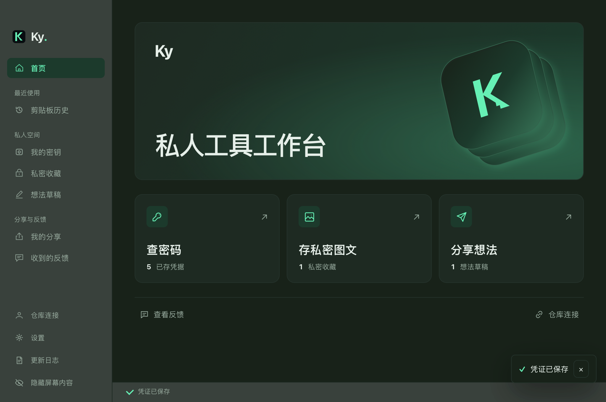

# Kyvault

Ky is a local encrypted workspace for passwords, quick notes and private images. Developer tools can use stored credentials by alias. No account required.

[Download for Apple Silicon Mac](https://github.com/webkubor/kyvault/releases/download/desktop-v0.3.3/Ky_0.3.3_aarch64.dmg) · [Website](https://webkubor.github.io/kyvault/) · [中文](README.md)

## On your Mac

- **Capture a thought.** Press ⌥⌘N to write and ⌘↩ to save privately. You can also collect selected text from a webpage. [Browser setup](desktop/browser/README.md)
- **Find a credential.** Search by platform or purpose, then open the result to reveal its value.
- **Share an idea.** Select paragraphs and images from a draft and copy the card into an editor that accepts images.

Sync your password vault to a private GitHub or GitLab repository. The master key and private notes stay on your Mac. [Desktop guide](desktop/README.md)

## From the terminal

With Rust installed, run `cargo install kyvault`. See the [CLI guide](docs/cli-guide.en.md) for other installation options, commands and backups, or [configure your agent](docs/agent-guide.md) to use credential aliases.

[Changelog](CHANGELOG.md) · [Security](SECURITY.md) · [Contributing](CONTRIBUTING.md) · [License](LICENSE)
