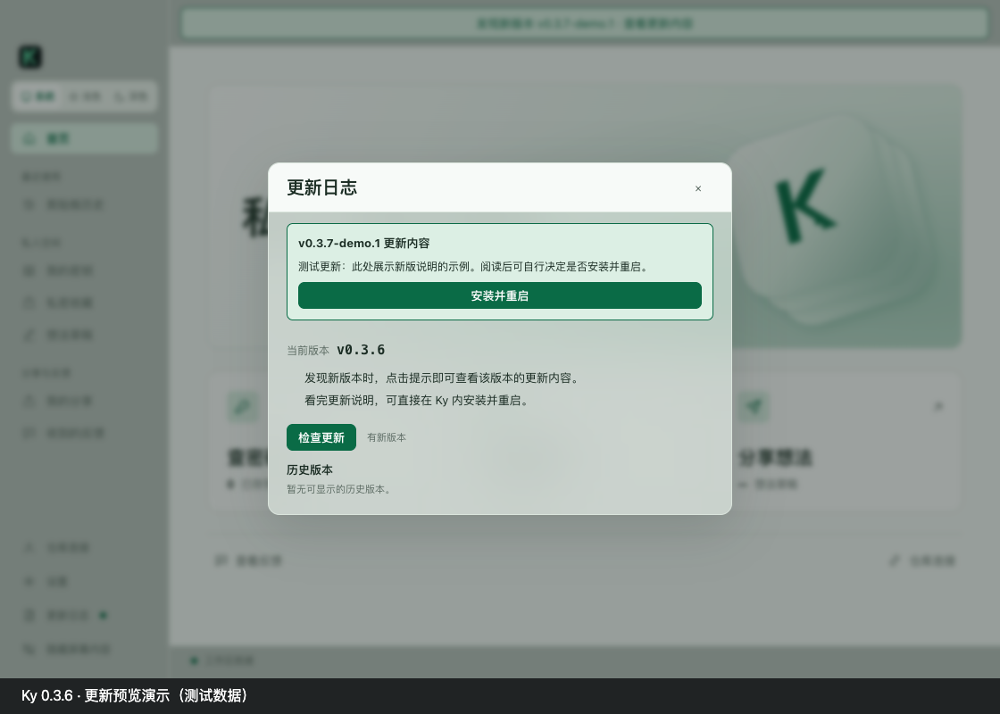

<h1 align="center"> Kyvault</h1>

<p align="center"><strong>Mac 上的本地密码库与私密闪记，也是开发者的命令行密钥管理工具。无需注册 Ky 账号。</strong></p>

<p align="center">
  <a href="https://github.com/webkubor/kyvault/actions/workflows/test.yml"></a>
  <a href="https://github.com/webkubor/kyvault/actions/workflows/desktop.yml"></a>
  <a href="https://github.com/webkubor/kyvault/releases/latest"></a>
  <a href="LICENSE"></a>
</p>

| 选哪个 | 可以做什么 | 下载 |
| --- | --- | --- |
| **Ky 桌面版** | 按平台查密码，按 ⌥⌘N 记下想法，把选中的图文复制为分享卡片。 | [Mac 0.3.6 · Apple Silicon（arm64）](https://github.com/webkubor/kyvault/releases/download/desktop-v0.3.6/Ky_0.3.6_aarch64.dmg) |
| **Kyvault 命令行** | 通过别名把 API Key 或 Token 传给子进程，命令里只写别名。 | [CLI 2.8.4 · macOS、Linux、Windows](https://github.com/webkubor/kyvault/releases/tag/v2.8.4) |

[官网](https://webkubor.github.io/kyvault/) · [English](README.en.md)

[](docs/assets/desktop/0.3.6/update-preview-zh.mp4)

点击截图播放演示：打开新版本提示，阅读更新说明，再取消重启。画面使用测试更新数据。

https://github.com/user-attachments/assets/bf222d0b-031a-44d5-8692-9b95b9b40a6d

## 在 Mac 上开始

- **记想法**　按 ⌥⌘N 直接写，⌘↩ 存到「私密收藏」。读网页时也可以选中文字，右键收进闪记。[按网站自动收藏](desktop/browser/README.md)
- **查密码**　在「我的密钥」搜平台和用途，例如「支付宝 私钥」。点开凭证就能查看原值。
- **分享图文**　选好草稿中的段落和配图，点「复制卡片」即可粘贴到支持图片的编辑器。

密码库可以同步到自己的 GitHub 或 GitLab 私有仓库。主密钥和私密图文留在本机。[桌面版使用说明](desktop/README.md)

## 在终端使用

运行 `cargo install kyvault` 安装命令行工具。假设已保存密钥 `secret://openai/api-key`，给它起个别名，再运行你的脚本。

```sh
kyvault alias set openai_key secret://openai/api-key
kyvault run --env OPENAI_API_KEY=openai_key -- python app.py
```

其他安装方式、命令示例和备份步骤见 [CLI 使用手册](docs/cli-guide.md)。要让 Codex 或 Claude Code 使用密钥别名，见 [Agent 配置](docs/agent-guide.md)。

[更新日志](CHANGELOG.md) · [安全说明](SECURITY.md) · [参与贡献](CONTRIBUTING.md) · [许可证](LICENSE)
