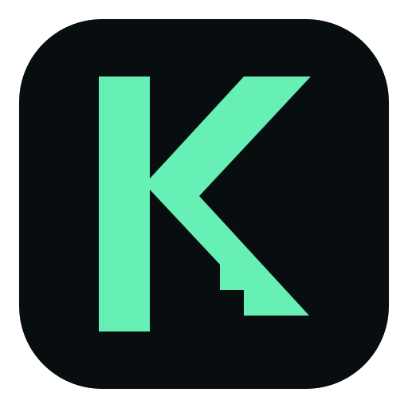
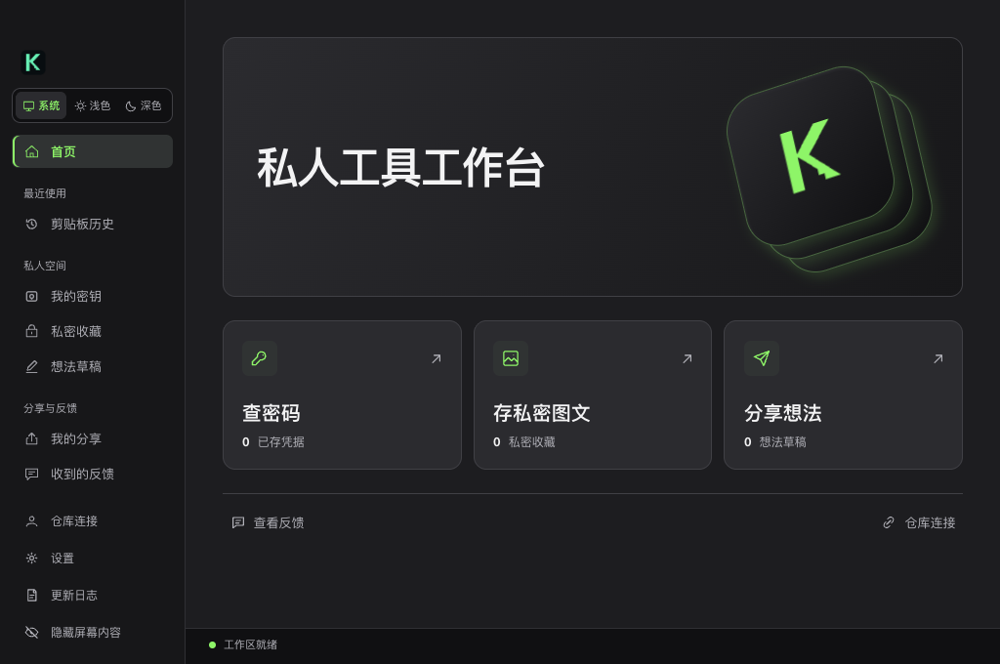

#  Kyvault

Kyvault 是给开发者用的本地密钥管理器。用 Ky 桌面版在 Mac 上查密码、记闪念、收藏图文；用命令行工具（CLI）以 AES-256-GCM 加密保存 API Key 和 Token，让 Codex、Claude Code 等工具通过别名使用凭据。

[](https://github.com/webkubor/kyvault/actions/workflows/test.yml) [](https://github.com/webkubor/kyvault/actions/workflows/desktop.yml) [](https://github.com/webkubor/kyvault/releases/latest) [](LICENSE)

**[下载 Ky 0.3.5 桌面版（Apple Silicon Mac）](https://github.com/webkubor/kyvault/releases/download/desktop-v0.3.5/Ky_0.3.5_aarch64.dmg)** · [下载 macOS、Linux、Windows 命令行版](https://github.com/webkubor/kyvault/releases/tag/v2.8.3) · [官网](https://webkubor.github.io/kyvault/) · [English](README.en.md)

[](docs/assets/desktop/home-motion.mp4)

https://github.com/user-attachments/assets/e23302a4-63e8-4180-a989-88c326ff67f4

## 在 Mac 上开始

- **记想法**　按 ⌥⌘N 直接写，⌘↩ 存到「私密收藏」。读网页时也可以选中文字，右键收进闪记。[按网站自动收藏](desktop/browser/README.md)
- **查密码**　在「我的密钥」搜平台和用途，例如「支付宝 私钥」。点开凭证就能查看原值。
- **分享图文**　选好草稿中的段落和配图，点「复制卡片」即可粘贴到支持图片的编辑器。

密码库可以同步到自己的 GitHub 或 GitLab 私有仓库。主密钥和私密图文留在本机。[桌面版使用说明](desktop/README.md)

## 在终端使用

已有 Rust 工具链时，运行以下命令安装 CLI 并查看可用命令。

```sh
cargo install kyvault
kyvault --help
```

其他安装方式、命令示例和备份步骤见 [CLI 使用手册](docs/cli-guide.md)。要让 Codex 或 Claude Code 使用密钥别名，见 [Agent 配置](docs/agent-guide.md)。

[更新日志](CHANGELOG.md) · [安全说明](SECURITY.md) · [参与贡献](CONTRIBUTING.md) · [许可证](LICENSE)
