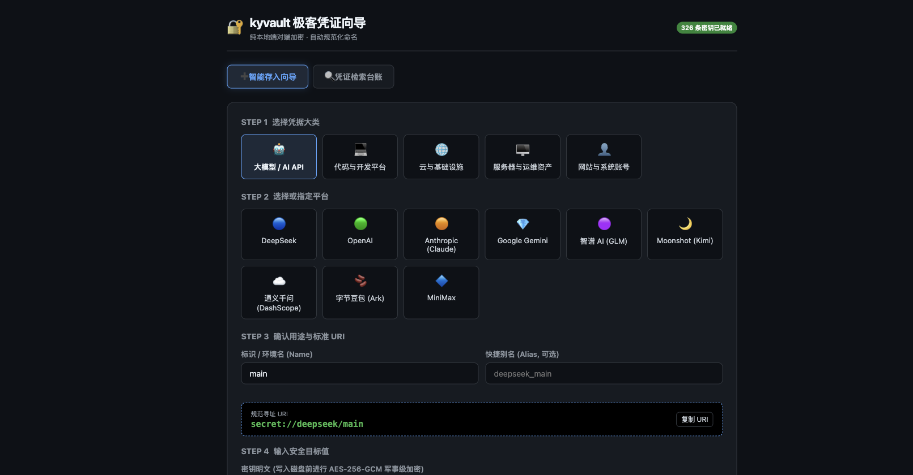
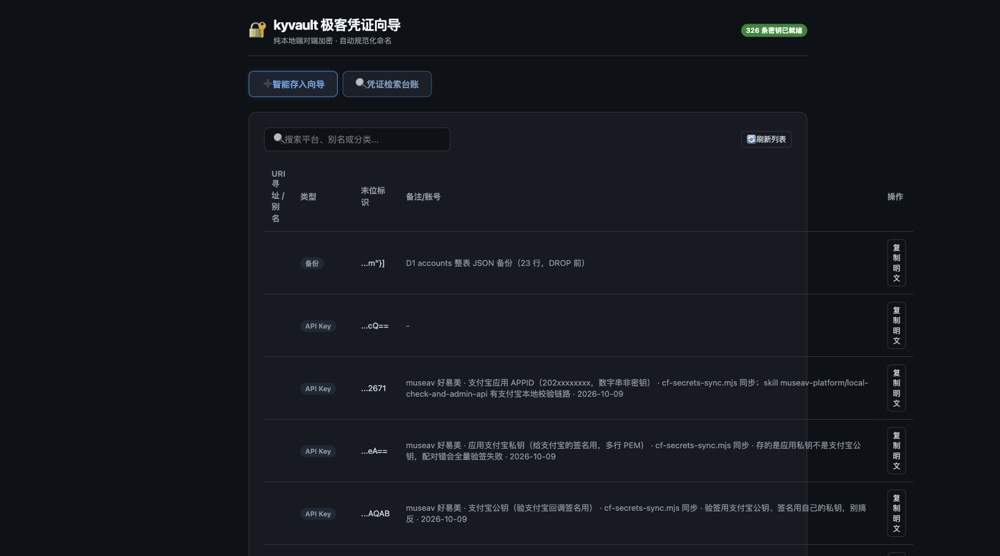

# Kyvault CLI guide

## 🎯 Kyvault behavior and boundaries

| Capability | Actual behavior and boundary |
|------|----------------|
| Local storage by default | The file backend uses AES-256-GCM encryption; reading and decryption need no network access. |
| Alias injection with `ky run` | Commands reference aliases or `secret://` URIs; values enter the child process environment at runtime without first passing through model context. |
| Plaintext reads with `ky get` | Prints the decrypted value to the terminal; an AI assistant running it may receive that output in its context. |
| Optional network features | API validation and balance checks, updates, GitLab sync, and the optional D1 backend access the network. |
| Child process output | A child process can read and print injected values; Kyvault does not sandbox it or automatically filter its logs. |

---


## 🖥️ Local GUI

Prefer clicking over typing? `ky ui` launches a local web GUI — wizard-based entry and a searchable ledger, zero commands required.

<p align="center">
  
</p>
<p align="center">
  <sub><b>Smart entry wizard</b> — choose a category and platform, the canonical URI is generated for you; paste the secret and click store.</sub>
</p>

<p align="center">
  
</p>
<p align="center">
  <sub><b>Credential ledger</b> — full-text search across the vault, filter by platform/alias, last-4 markers help you recognize entries without exposing full values.</sub>
</p>

The GUI binds to `127.0.0.1` only, and every launch uses a fresh random token in the URL — other pages open in your browser cannot read your secrets.

**macOS: one-click Dock icon** (click the icon = open the GUI, no terminal needed):

```bash
bash scripts/make-dock-app.sh   # builds ~/Applications/Kyvault GUI.app; drag it into the Dock
```

---


## ⚡ 30-second start

```bash
# Install and init
curl -fsSL https://raw.githubusercontent.com/webkubor/kyvault/main/install.sh | bash

# or, with a Rust toolchain
cargo install kyvault

# Add rules for supported local AI assistants (Claude/Codex/Hermes/Cursor)
kyvault connect

# Construct commands with references; avoid printing secrets from the child
kyvault run --env GITHUB_TOKEN=secret://github/personal-pat -- git push
```

> **Short command `ky`:** The installer creates a `ky` symlink to `kyvault`. Both commands use the same binary and subcommands: `ky init`, `ky run`, and `ky connect` are equivalent to their `kyvault` forms.

---


## 📖 Usage guide

### Account management

```bash
# Save account (username + password)
kyvault account set github user@gmail.com mypassword123
kyvault account set github admin@gmail.com adminpass456

# Read password
kyvault account get github user@gmail.com

# List accounts under a platform
kyvault account list github

# Delete account
kyvault account delete github user@gmail.com
```

### Key management

```bash
# Save platform key (API Key, Token, etc.)
kyvault key set github ghp_xxxxxxxxxxxx
kyvault key set openai sk-xxxxxxxxxxxx

# Read key
kyvault key get github ghp_xxxxxxxxxxxx

# List keys under a platform
kyvault key list github

# Delete key
kyvault key delete github ghp_xxxxxxxxxxxx
```

### Platform query

```bash
# List all platforms and summary
kyvault platform

# Detail of a specific platform
kyvault platform github
```

### AI integration

```bash
# Push code
kyvault run --env GITHUB_TOKEN=secret://github/pat -- git push

# Call API
kyvault run --env OPENAI_API_KEY=secret://openai/api-key -- python app.py

# Multiple keys
kyvault run --env TOKEN1=secret://example/first --env TOKEN2=secret://example/second -- python script.py
```

### Alias system

```bash
# Create alias (this is what AI sees)
kyvault alias set github_token secret://github/pat

# Inject via alias
kyvault run --env GITHUB_TOKEN=github_token -- git push
```

### Migrate from `.env`

```bash
# Preview (no actual import)
kyvault import --file .env --dry-run

# Import everything
kyvault import --file .env

# Only import GitHub-related
kyvault import --file .env --prefix GITHUB_
```

### 🤖 AI agent one-key connect

Global and project-local rules explain the vault and alias workflow to AI coding assistants (Cursor, VSCode Copilot, Claude Code, etc.) and guide them to prefer injection commands:

```bash
# Auto-connect global Gemini rules and the project's .agents/, .cursorrules, .copilotinstructions
kyvault connect
```

### 🖥️ Server password & rent ledger

First-class encrypted storage for all your server records, addressable via `secret://` for direct AI lookup:

```bash
# 1. Save server (required: hostname, IP, root password; optional: monthly rent, cloud provider)
kyvault server set my-host 120.46.12.3 rootpwd123 --cost "99元/月" --provider "Tencent Cloud"

# 2. Read full record
kyvault server get my-host

# 3. Read one encrypted field (secret:// URI route-compatible)
kyvault server get my-host --field ip            # output: 120.46.12.3
kyvault get secret://server/my-host/root-password # output: rootpwd123
```

### 🔌 CLI client multi-token maintenance

Unified token maintenance for multi-account / multi-environment CLIs:

```bash
# 1. Store tokens for different accounts of a CLI
kyvault cli set studio-cli webkubor jwt_token_main
kyvault cli set studio-cli test-user jwt_token_test

# 2. Query encrypted token for a profile
kyvault cli get studio-cli webkubor              # output: jwt_token_main
kyvault get secret://cli/studio-cli/test-user   # output: jwt_token_test
```

---


## 📁 Security architecture

```
~/.keyring/
├── master.key       # AES-256 key (chmod 600)
└── secrets.json     # Encrypted accounts/keys (AES-256-GCM)
```

### Storage structure

```json
{
  "github": {
    "accounts": {
      "user@gmail": "encrypted_password_1",
      "admin@gmail": "encrypted_password_2"
    },
    "keys": {
      "ghp_xxx": "encrypted_key_1",
      "ghp_yyy": "encrypted_key_2"
    }
  }
}
```

- **Encryption algorithm**: AES-256-GCM (authenticated encryption)
- **Key derivation**: SHA-256
- **Storage**: Local file backend by default; optional GitLab ciphertext sync or D1 backend
- **Permissions**: master.key readable only by owner

---


## 📋 Quick command reference

| Alias | Full | Purpose | Example |
|------|------|------|------|
| - | `kyvault init` | Initialize | `kyvault init` |
| **Account management** | | | |
| `kyvault account set` | `kyvault account set` | Store account | `kyvault account set github user@gmail pass` |
| `kyvault account get` | `kyvault account get` | Read password | `kyvault account get github user@gmail` |
| `kyvault account list` | `kyvault account list` | List accounts | `kyvault account list github` |
| `kyvault account delete` | `kyvault account delete` | Delete account | `kyvault account delete github user@gmail` |
| **Key management** | | | |
| `kyvault key set` | `kyvault key set` | Store key | `kyvault key set github ghp_xxx value` |
| `kyvault key get` | `kyvault key get` | Read key | `kyvault key get github ghp_xxx` |
| `kyvault key list` | `kyvault key list` | List keys | `kyvault key list github` |
| `kyvault key delete` | `kyvault key delete` | Delete key | `kyvault key delete github ghp_xxx` |
| **Platform query** | | | |
| - | `kyvault platform` | Platform list | `kyvault platform` |
| `kyvault platform <name>` | `kyvault platform <name>` | Platform detail | `kyvault platform github` |
| **API validation** | | | |
| - | `kyvault check` | Validate key | `kyvault check openai --key sk-xxx` |
| - | `kyvault check email` | Re-verify mail app password via IMAP | `kyvault check email gmail-app-password` |
| - | `kyvault add` | Browser entry: normalize → verify → save | `kyvault add --email you@gmail.com` |
| - | `kyvault providers` | Supported platforms | `kyvault providers` |
| **AI integration** | | | |
| - | `kyvault run` | Inject env | `kyvault run --env X=val -- cmd` |
| - | `kyvault connect` | AI smart connect | `kyvault connect` |
| **Encrypted asset ledger** | | | |
| - | `kyvault server set` | Store server | `kyvault server set host 1.1.1.1 pw` |
| - | `kyvault server get` | Read server | `kyvault server get host` |
| - | `kyvault server list` | List servers | `kyvault server list` |
| - | `kyvault server delete`| Delete server | `kyvault server delete host` |
| - | `kyvault cli set` | Store CLI token | `kyvault cli set tool prof token` |
| - | `kyvault cli get` | Read CLI token | `kyvault cli get tool prof` |
| - | `kyvault cli list` | List CLI tokens | `kyvault cli list` |
| - | `kyvault cli delete`| Delete CLI token | `kyvault cli delete tool prof` |
| **GitLab Team Collaboration** | | | |
| - | `kyvault gitlab status` | Vault status | `kyvault gitlab status` |
| - | `kyvault gitlab pull` | Pull latest | `kyvault gitlab pull` |
| - | `kyvault gitlab push` | Commit & push | `kyvault gitlab push` |
| - | `kyvault gitlab sync` | Auto sync (pull+push)| `kyvault gitlab sync` |
| - | `kyvault gitlab setup`| Clone team repo | `kyvault gitlab setup git@gitlab.com:org/vault.git` |
| **Self-check & update** | | | |
| - | `kyvault doctor` | Tool self-check + repair | `kyvault doctor` |
| - | `kyvault update` | Replace the running executable with the stable CLI release (`-y` skips confirmation) | `kyvault update` |

For standalone macOS and GNU/Linux installs, run `ky update` or use `kyvault update -y` to skip confirmation. Starting with 2.8.4, the updater follows symlinks, checks the downloaded version and replaces the running executable. It skips the installer’s legacy Python cleanup. For read-only directories, hard links and package-managed installations, use the original installation channel. On Windows x64, exit the CLI, extract the release ZIP and replace `kyvault.exe`.

---


## 🤖 Compatible platforms

### LLM providers

| Platform | Logo | Verify | Alias inject |
|------|------|------|----------|
| OpenAI | 🟢 | `kyvault check openai --key sk-xxx` | ✅ |
| DeepSeek | 🔵 | `kyvault check deepseek --key sk-xxx` (with balance) | ✅ |
| Zhipu AI | 🟣 | `kyvault check zhipu --key xxx` (with balance) | ✅ |
| Moonshot (Kimi) | 🌙 | `kyvault check moonshot --key sk-xxx` (with balance) | ✅ |
| Anthropic (Claude) | 🟠 | `kyvault check anthropic --key sk-ant-xxx` | ✅ |
| Google Gemini | 💎 | `kyvault check gemini --key xxx` | ✅ |
| Tongyi Qianwen (Qwen) | ☁️ | `kyvault check qwen --key sk-xxx` | ✅ |
| MiniMax | 🔷 | `kyvault check minimax --key xxx` | ✅ |
| ByteDance Doubao | 🫘 | `kyvault check doubao --key xxx` (with balance) | ✅ |
| Groq | ⚡ | `kyvault check groq --key gsk_xxx` | ✅ |
| Together AI | 🤝 | `kyvault check together --key xxx` | ✅ |
| OpenRouter | 🔀 | `kyvault check openrouter --key sk-or-xxx` | ✅ |
| Fireworks AI | 🔥 | `kyvault check fireworks --key xxx` | ✅ |
| SiliconFlow | 🧊 | `kyvault check siliconflow --key sk-xxx` | ✅ |
| Baichuan | 🌊 | `kyvault check baichuan --key xxx` | ✅ |
| iFlytek Spark | ✨ | `kyvault check spark --key xxx` | ✅ |
| Aliyun Bailian | ☁️ | `kyvault check aliyun --key xxx` (with balance) | ✅ |

### Dev & ops platforms

| Platform | Logo | Verify | Alias inject |
|------|------|------|----------|
| GitHub | 🐙 | `kyvault check github --key ghp_xxx` | ✅ |
| Cloudflare | 🧡 | `kyvault check cloudflare --key cloudflare_token` | ✅ |
| GitLab | 🦊 | `kyvault check gitlab --key glpat-xxx` | ✅ |
| Feishu | 🐦 | `kyvault check feishu --key tenant_access_token` | ✅ |


## ❓ FAQ

#### Q: I only have a Node environment on my machine — do I need Python?

**A: No.**

Kyvault provides prebuilt Rust binaries; encryption uses `aes-gcm` (AES-256-GCM), TLS uses `rustls`. **Prebuilt versions need no Python, Node, or Rust toolchain**. Linux release targets use the GNU ABI and still require compatible system libraries.

This is deliberate: the vault is the foundation that every credential-needing job depends on, so it can't rely on any single runtime that might break. The previous Python version paid for this lesson — on some machines, the interpreter's TLS validation fails entirely (same cert chain, `openssl verify` says OK, `curl` connects, but Python reports `CERTIFICATE_VERIFY_FAILED`); the key write channel went read-only on the spot.

---
