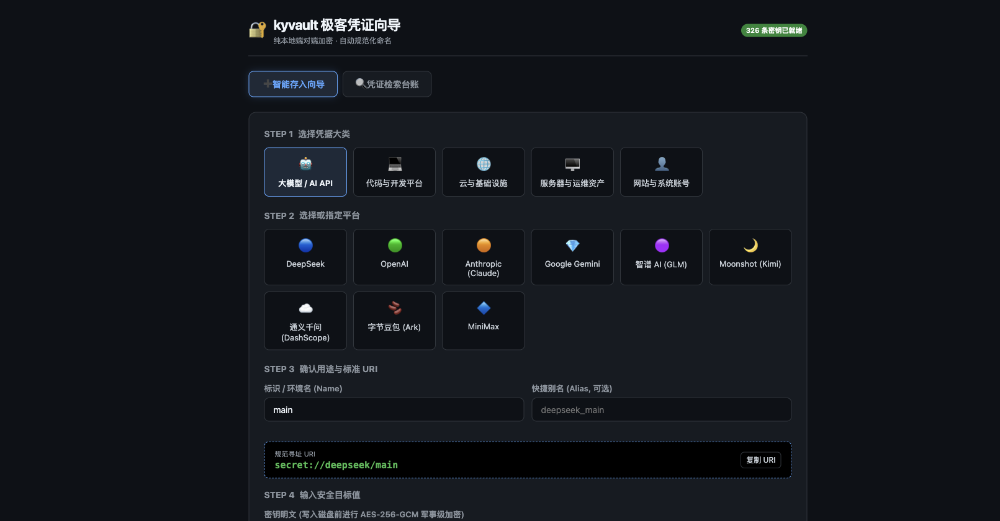
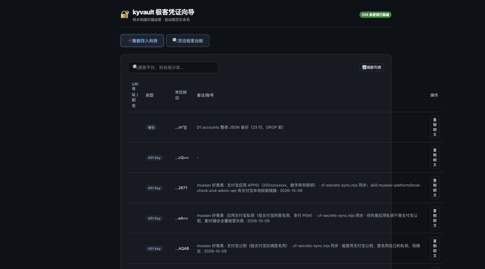

# Kyvault CLI 使用手册

## 🎯 Kyvault 的行为与边界

| 能力 | 实际行为与边界 |
|------|----------------|
| 默认本地存储 | 文件后端使用 AES-256-GCM 加密，读取与解密无需联网。 |
| `ky run` 别名注入 | 命令只需引用别名或 `secret://` URI，值在运行时传入子进程环境，无需先交给模型上下文。 |
| `ky get` 明文读取 | 会将解密后的值输出到终端；交给 AI 执行时，输出可能进入模型上下文。 |
| 可选网络功能 | API 验证与余额查询、更新、GitLab 同步和可选 D1 后端会访问网络。 |
| 子进程输出 | 子进程能读取并输出注入的值；Kyvault 不隔离子进程，也不自动过滤其日志。 |

---


## 🖥️ 本地 GUI

不想敲命令？`ky ui` 一键唤起本地极客 Web GUI —— 向导式录入、可视化检索，全程零命令。

<p align="center">
  
</p>
<p align="center">
  <sub><b>智能存入向导</b> —— 选大类 → 选平台 → URI 自动生成，粘贴密钥点「安全加密存入」即完成。</sub>
</p>

<p align="center">
  
</p>
<p align="center">
  <sub><b>凭证检索台账</b> —— 全库检索、按平台/别名过滤，末位标识辅助辨认（不暴露完整密钥）。</sub>
</p>

GUI 只绑 `127.0.0.1`，地址带每次启动随机生成的 token —— 本机其他网页借不走你的明文。

**macOS 用户还可以一键生成 Dock 图标**（点图标 = 打开 GUI，不用开终端）：

```bash
bash scripts/make-dock-app.sh   # 生成 ~/Applications/Kyvault GUI.app，拖进 Dock 即可
```

---


## ⚡ 30 秒上手

```bash
# 1. 安装最新稳定 CLI 版本（不跟随 Ky.app 发布）
curl -fsSL https://raw.githubusercontent.com/webkubor/kyvault/main/install.sh | bash

# 或者指定 CLI 版本（下载失败时不会改装其他版本）
curl -fsSL https://raw.githubusercontent.com/webkubor/kyvault/main/install.sh | bash -s -- v2.8.2

# 或者用 Cargo（需要 Rust 工具链）
cargo install kyvault

# 2. 一键连接本地所有 AI 智能体 (Claude / Codex / agy / Hermes / Cursor)
ky connect

# 3. 浏览器录入凭据：自动去空格 → 找旧条目 → 先验证，通过才写库
ky add                              # 也可 --email you@gmail.com / --email you@163.com --login / --provider deepseek

#    极客 Web GUI 可视化检索（自动打开本地浏览器，地址带一次性随机 token）
ky ui

#    macOS：一键生成 Dock 图标，点图标即开 GUI（见上方「本地 GUI」节）
bash scripts/make-dock-app.sh

# 4. 或命令行引导式规范录入
ky wizard

# 5. 以凭证引用构造命令，运行时注入（避免子进程输出密钥）
ky run --env GITHUB_TOKEN=secret://github/pat -- git push
```

> 💡 **关于快捷短命令 `ky`**：`ky` 是 `kyvault` 的官方第一公民短命令，两者完全等价。敲 `ky list`、`ky run`、`ky ui` 即可体验极致的极客开发流。

---


## 📖 使用指南

### 账户管理

```bash
# 保存账户（用户名+密码）
kyvault account set github user@gmail.com mypassword123
kyvault account set github admin@gmail.com adminpass456

# 读取密码
kyvault account get github user@gmail.com

# 列出平台下所有账户
kyvault account list github

# 删除账户
kyvault account delete github user@gmail.com
```

### 密钥管理

```bash
# 保存平台密钥（API Key、Token 等）
kyvault key set github ghp_xxxxxxxxxxxx
kyvault key set openai sk-xxxxxxxxxxxx

# 读取密钥
kyvault key get github ghp_xxxxxxxxxxxx

# 列出平台下所有密钥
kyvault key list github

# 删除密钥
kyvault key delete github ghp_xxxxxxxxxxxx
```

### 平台查询

```bash
# 列出所有平台及摘要
kyvault platform

# 查看指定平台详情
kyvault platform github
```

### AI 集成

```bash
# 推代码
kyvault run --env GITHUB_TOKEN=secret://github/pat -- git push

# 调 API
kyvault run --env OPENAI_API_KEY=secret://openai/api-key -- python app.py

# 多个密钥
kyvault run --env TOKEN1=secret://example/first --env TOKEN2=secret://example/second -- python script.py
```

### 别名系统

```bash
# 创建别名（AI 只认识这个）
kyvault alias set github_token secret://github/pat

# 用别名注入
kyvault run --env GITHUB_TOKEN=github_token -- git push
```

### 从 .env 迁移

```bash
# 预览（不实际导入）
kyvault import --file .env --dry-run

# 导入全部
kyvault import --file .env

# 只导入 GitHub 相关
kyvault import --file .env --prefix GITHUB_
```

### 🤖 AI 智能体一键连接 (AI Connect)

通过全局和项目本地规则，向 AI 编码助手（如 Cursor、VSCode Copilot、Claude Code 等）说明密钥库与别名用法，引导其优先使用注入命令：
```bash
# 一键自动对接全局 Gemini 规则和当前项目下的 .agents/、.cursorrules 和 .copilotinstructions
kyvault connect
```

### 🖥️ 服务器密码与租金台账 (Server Ledger)

以第一公民命令格式加密存储您的所有服务器台账，支持以 `secret://` 的形式让 AI 直接寻址解密：
```bash
# 1. 保存服务器（必填：主机名、IP、root密码；可选：月租成本、云服务商）
kyvault server set my-host 120.46.12.3 rootpwd123 --cost "99元/月" --provider "腾讯云"

# 2. 查询全部台账信息
kyvault server get my-host

# 3. 指定读取单个加密字段（支持 secret:// URI 路由兼容，完美服务 AI）
kyvault server get my-host --field ip            # 输出: 120.46.12.3
kyvault get secret://server/my-host/root-password # 输出: rootpwd123
```

### 🔌 CLI 客户端多 Token 维护 (CLI Multi-Tokens)

用于多账户、多环境切换的 CLI 统一 Token 凭证维护：
```bash
# 1. 为指定 CLI 的不同账户存储 Token
kyvault cli set studio-cli webkubor jwt_token_main
kyvault cli set studio-cli test-user jwt_token_test

# 2. 查询指定 Profile 的加密令牌
kyvault cli get studio-cli webkubor             # 输出: jwt_token_main
kyvault get secret://cli/studio-cli/test-user   # 输出: jwt_token_test
```

### 🧾 账号体系、操作审计与只读面板

三件事补上「谁、哪个账号、别人能不能看」这一层：

```bash
# 1. 一个 profile = 一个账号，把散在各平台的凭据收成一组
kyvault profile add work --platform github --username alice --org acme --cli gh \
  --link secret://github/pat
kyvault profile use work          # 切换当前账号
kyvault run --profile work -- npm run deploy   # 整组注入：变量名 = ref 名大写（PAT）

# 2. 审计：谁在什么时候读过/改过哪条（只记 ref 与时间，不记明文）
kyvault audit --limit 50
kyvault audit --action get --actor alice --json
# 操作人：--as <名字> > KY_ACTOR > 库内 git user.name > $USER
# 团队谁改的：git log 的提交信息已带操作者（chore(secrets): sync by <name> at <ts>）

# 3. 只读面板：导出静态 HTML，可以放任何静态托管
kyvault panel --out panel.html
```

面板不含凭据值、密文或尾号，但账号、IP、设备与审计仍属于敏感元信息，应使用带访问控制的站点托管；`noindex` 不能代替登录鉴权。可写、能查看明文的 `kyvault ui` 仅绑定 `127.0.0.1`，且地址带每次启动随机生成的 token、只收 JSON POST、不返回 CORS 头 —— 只绑本机挡不住本机浏览器里打开的其他网页。

### 服务器 Agent 协作（实验性）

在受信密码库主机上，由本地管理员审批设备公钥、来源 IP 与逐条授权：

```bash
kyvault broker register prod-agent --principal agent:deploy \
  --pubkey /path/to/agent.pub --allow-ip 192.0.2.10 \
  --allow-ref secret://github/deploy --ttl-hours 24
kyvault broker authorized-key prod-agent
kyvault broker status
kyvault broker revoke prod-agent
```

`authorized-key` 只生成配置行供审阅，不会修改 SSH 设置。管理员应将其装入专用账户的 `authorized_keys`，使用 OpenSSH `restrict`、`from=` 与 fixed command；Agent 不得拥有该账户的其他登录路径。store、程序和授权文件必须由可信管理员维护，目录仅本人可读。不能把环境变量 `SSH_CONNECTION` 单独当认证；身份成立依赖正确的 sshd/forced-command 部署。`principal` 与 `--as` 仍是人工标签，认证的是登记的 SSH key，不检测私钥是否被复制。

Agent 通过专用 SSH config、已确认的 broker host key 连接，并核对预期设备：

```bash
kyvault broker probe --host vault-broker --expect-device prod-agent \
  --ssh-config /path/to/broker-ssh-config
kyvault broker run --host vault-broker --expect-device prod-agent \
  --ssh-config /path/to/broker-ssh-config \
  --env GITHUB_TOKEN=secret://github/deploy -- git push
```

Agent 使用自己的 SSH 私钥，不拿整库 master key。新请求受 IP、精确 ref、期限与撤销约束，服务端审计写失败则不释放凭据；服务端审计文件仍不防本机管理员篡改。撤销只阻止后续发放；已获准的请求和已复制的静态值不能追回。Mac/Windows 主设备签名审批与自动 enrollment 尚未完成。Broker 主机当前需支持 POSIX shell/OpenSSH；Windows 可作为 SSH 客户端，原生 Windows broker 尚未验收。

### 凭据有效性与重复监察

```bash
kyvault check openai production  # 联网检查，保存状态、HTTP 分类、检查时间和耗时
kyvault check email 163-smtp-auth  # 邮箱授权码 / 应用专用密码：IMAP 登录验证，邮箱取条目账号备注
kyvault inspect                  # 离线只读：类型/平台/账户、孤儿关联、时间问题与历史健康状态
kyvault inspect --duplicates     # 显式解密比较重复值；仅输出引用分组，不输出值、尾号或指纹
```

健康检查不把网络错误、403 或 429 判作凭据失效。`check` 返回 0 表示通过/限流（限流不证明认证成功），1 表示认证失败，2 表示权限/网络/接口等未知问题；不要用任意非零退出码自动轮换。报告显示的是最近一次记录，默认不联网。计划任务可由操作系统调度，当前没有自动创建周期任务或通知渠道。

### 🦊 已有 glab？不用再抄一遍 PAT

本机 `glab auth login` 过之后，`kyvault init --remote <仓库地址>` 会直接复用 glab 的登录态建私有库并首推：

```bash
kyvault gitlab auth        # 先看当前会用哪把凭证（env / glab 配置文件 / glab CLI）
kyvault init --remote https://gitlab.com/team/vault.git
```

凭证优先级：`KY_GITLAB_TOKEN` → `glab` 配置文件 → `glab auth status --show-token`。
调 API 优先走 `glab api`（token 不进 `ps`），没有 glab 才回落 `curl` 且 token 走 stdin。

---


## 📁 安全架构与 master.key 核心规范

```
~/.config/kyvault/store/ (GitLab 团队仓库)
├── auth.json        # Auth Guard 授权方法配置 (SSH 指纹、TOTP 加密 secret)
├── master.key.enc   # 旧版兼容包裹文件（不是有效的公钥加密保护）
├── secrets.json     # AES-256-GCM 加密密文 (入仓 Git 同步)
├── meta.json        # 审计元信息 (脱敏, 记录更新时间、last4、scopes、组织)
├── accounts.json    # 账号注册表 (profile / 登录名 / 组织 / ref; 不含密钥材料, 入仓)
├── audit.log        # 操作审计 (谁读过/改过哪条; 有读事件, 默认不入仓)
└── .lock            # 跨进程文件排他锁 (防止 Agent 并发写入冲突)
```

### 🛡️ 旧版 Auth Guard 配置（仅兼容）

```bash
# 这些命令只读取/关闭旧 auth.json；setup/add 默认拒绝，兼容迁移需显式设置 KYVAULT_ALLOW_INSECURE_LEGACY_AUTH=1。
kyvault auth status
kyvault auth list
```

> 旧格式使用公开 SSH `.pub` 内容派生 key，且 TOTP 校验未接入敏感命令。请勿把它用于密库保密或远程 Agent 授权。方案见 [人类与 Agent 协作提案](proposals/2026-10-22-human-agent-collaboration.md)。

### 📋 人类与 Agent 协作安全边界

| 模式 | 用途 | 访问权限 |
|---|---|---|
| 本地 file | 单机用户与本地 Agent | 能解锁该 vault 的进程可读全库 |
| Git Sync | 小型可信组同步密文 | 同一 master key 的持有者可读全库；IP 与 `visibility` 不做授权 |
| Broker（实验性 CLI 原型） | SSH 设备身份 + IP/CIDR + 精确 ref + 期限/撤销 | Server 持有整库 root key；Agent 仅请求获准条目，不 clone 密库 |

Broker 使用 OpenSSH forced command，不是公网服务。必须由管理员在专用低权限 SSH 账户安装生成的 `authorized_keys` 行，并通过 sshd policy 禁止交互 shell、SFTP、用户 startup hooks、环境覆盖与其他登录 key。IP 取 `SSH_CONNECTION` 并与 OpenSSH `from=` 双重约束。`--as` 是人工审批标签，不是 Mac/Windows 主设备签名；当前每条响应都返回请求的静态值，拿到值的进程仍可保留或外传。启用前应在隔离测试账号和服务器上 review 部署。

- 本地 `audit.log` 与 `--as` 仅为操作线索，不是认证后的不可抵赖审计。
- 有效性检查、到期/重复监察、多平台多账号、设备登记与 Agent Grant 的分阶段方案见 [人类与 Agent 协作提案](proposals/2026-10-22-human-agent-collaboration.md)。
- 文件后端的 AES-GCM 负责认证加密；公开明文 SHA-256 不作为共享重复检测指纹。

### 🔑 什么是 master.key？
`master.key` 是在本地生成的 32 字节（256 位）高强度安全随机数（以 44 字符的标准 Base64 编码保存）。
它是整套密钥库加解密的**唯一根凭据**：
1. **纯本地计算**：kyvault 使用 `SHA-256(Base64Decode(master.key))` 派生 AES 密钥，对每条凭证生成独立 12 字节随机 Nonce 进行 AES-256-GCM 认证加密。解密零网络依赖。
2. **物理隔离与绝对不入仓**：`master.key` / `master.key.enc` 被 `.gitignore` 强力排除，`kyvault gitlab push` 前会进行双重防泄露检查。
3. **本地查看与迁移备份**（明文 master.key 模式）：
   ```bash
   kyvault master-key           # 查看路径、权限、SHA-256 指纹
   kyvault master-key --reveal  # 导出明文（备份至 1Password / 换机迁移）
   ```

### 存储结构 (secrets.json)

```json
{
  "github": {
    "accounts": {
      "user@gmail": "encrypted_password_1",
      "admin@gmail": "encrypted_password_2"
    },
    "keys": {
      "ghp_xxx": "encrypted_key_1",
      "ghp_yyy": "encrypted_key_2"
    }
  }
}
```

- **加密算法**: AES-256-GCM（认证加密）
- **密钥派生**: SHA-256
- **包装文件**: 旧版 `master.key.enc` 格式只为兼容保留，不验证 SSH 私钥，不能视为安全保护
- **存储与同步**: 本地脱机解密，GitLab 团队密文同步
- **权限与并发**: master.key.enc 仅当前用户可读写 (0600)，跨进程 `.lock` 排他锁

---


## 📋 命令速查

| 快捷 | 完整 | 用途 | 示例 |
|------|------|------|------|
| - | `kyvault init` | 初始化主密钥与目录 | `kyvault init` |
| - | `kyvault master-key` | 查看主密钥路径与指纹 | `kyvault master-key` (加 `-r` 显明文) |
| **账户管理** | | | |
| `kyvault account set` | `kyvault account set` | 存账户 | `kyvault account set github user@gmail pass` |
| `kyvault account get` | `kyvault account get` | 读密码 | `kyvault account get github user@gmail` |
| `kyvault account list` | `kyvault account list` | 列账户 | `kyvault account list github` |
| `kyvault account delete` | `kyvault account delete` | 删账户 | `kyvault account delete github user@gmail` |
| **密钥管理** | | | |
| `kyvault key set` | `kyvault key set` | 存密钥 | `kyvault key set github ghp_xxx value` |
| `kyvault key get` | `kyvault key get` | 读密钥 | `kyvault key get github ghp_xxx` |
| `kyvault key list` | `kyvault key list` | 列密钥 | `kyvault key list github` |
| `kyvault key delete` | `kyvault key delete` | 删密钥 | `kyvault key delete github ghp_xxx` |
| **平台查询** | | | |
| - | `kyvault platform` | 平台列表 | `kyvault platform` |
| `kyvault platform <name>` | `kyvault platform <name>` | 平台详情 | `kyvault platform github` |
| **API 验证** | | | |
| - | `kyvault check` | 验证 key 有效性与余额 | `kyvault check openai --key sk-xxx` |
| - | `kyvault check email` | IMAP 复验邮箱授权码 | `kyvault check email gmail-app-password` |
| - | `kyvault add` | 浏览器录入凭据（先验证再写库） | `kyvault add --email you@163.com` (或 `ky add`) |
| - | `kyvault request` | Agent 声明录入请求 → 人粘密文 → 自动校验入库建别名 | `ky request declare --platform github --name ci-token --alias github_token --open` (或 `ky req`) |
| - | `kyvault providers` | 支持平台列表 | `kyvault providers` |
| **AI 集成** | | | |
| - | `kyvault run` | 注入env单向执行 | `kyvault run --env X=val -- cmd` |
| - | `kyvault connect` | AI 智能对接 (全Agent规则) | `kyvault connect` |
| **加密资产台账** | | | |
| - | `kyvault server set` | 存服务器台账 | `kyvault server set host 1.1.1.1 pw` |
| - | `kyvault server get` | 读服务器台账 | `kyvault server get host` |
| - | `kyvault server list` | 列服务器台账 | `kyvault server list` |
| - | `kyvault server delete`| 删服务器台账 | `kyvault server delete host` |
| - | `kyvault cli set` | 存 CLI Token | `kyvault cli set tool prof token` |
| - | `kyvault cli get` | 读 CLI Token | `kyvault cli get tool prof` |
| - | `kyvault cli list` | 列 CLI Token | `kyvault cli list` |
| - | `kyvault cli delete`| 删 CLI Token | `kyvault cli delete tool prof` |
| **GitLab 团队协作** | | | |
| - | `kyvault gitlab status` | 团队库同步与安全检查 | `kyvault gitlab status` |
| - | `kyvault gitlab pull` | 拉取最新密文与元信息 | `kyvault gitlab pull` |
| - | `kyvault gitlab push` | 提交推送密文 (严查key) | `kyvault gitlab push` |
| - | `kyvault gitlab sync` | 自动同步 (pull+push) | `kyvault gitlab sync` |
| - | `kyvault gitlab setup`| 克隆团队仓库至本地 | `kyvault gitlab setup git@gitlab.com:org/vault.git` |
| `Auth Guard` | 旧配置只读与关闭；setup/add 默认禁止，兼容迁移需显式 opt-in | `kyvault auth status` |
| - | `kyvault auth setup` | 交互式首次配置 | `kyvault auth setup` |
| - | `kyvault auth add` | 添加授权方法 | `kyvault auth add ssh ~/.ssh/id_ed25519.pub` |
| - | `kyvault auth list` | 查看已绑定方法 | `kyvault auth list` |
| - | `kyvault auth remove` | 移除授权方法 | `kyvault auth remove ssh-id_rsa` |
| - | `kyvault auth disable` | 关闭守卫 | `kyvault auth disable` |
| - | `kyvault auth status` | 守卫状态概览 | `kyvault auth status` |
| **引导与图形界面** | | | |
| - | `kyvault ui` | 启动本地极客 Web GUI（自动唤起浏览器，地址带随机 token） | `kyvault ui` (或 `ky ui`) |
| - | `kyvault wizard` | 交互式分类引导向导 (规范URI) | `kyvault wizard` (或 `ky wizard`) |
| **自检与更新** | | | |
| - | `kyvault doctor` | 工具自检修复 | `kyvault doctor` |
| - | `kyvault update` | 在线升级工具 | `kyvault update` |

---


## 🤖 兼容平台

### LLM 大模型

| 平台 | Logo | 验证 | 别名注入 |
|------|------|------|----------|
| OpenAI | 🟢 | `kyvault check openai --key sk-xxx` | ✅ |
| DeepSeek | 🔵 | `kyvault check deepseek --key sk-xxx`（含余额） | ✅ |
| 智谱 AI | 🟣 | `kyvault check zhipu --key xxx`（含余额） | ✅ |
| Moonshot (Kimi) | 🌙 | `kyvault check moonshot --key sk-xxx`（含余额） | ✅ |
| Anthropic (Claude) | 🟠 | `kyvault check anthropic --key sk-ant-xxx` | ✅ |
| Google Gemini | 💎 | `kyvault check gemini --key xxx` | ✅ |
| 通义千问 | ☁️ | `kyvault check qwen --key sk-xxx` | ✅ |
| MiniMax | 🔷 | `kyvault check minimax --key xxx` | ✅ |
| 字节豆包 | 🫘 | `kyvault check doubao --key xxx`（含余额） | ✅ |
| Groq | ⚡ | `kyvault check groq --key gsk_xxx` | ✅ |
| Together AI | 🤝 | `kyvault check together --key xxx` | ✅ |
| OpenRouter | 🔀 | `kyvault check openrouter --key sk-or-xxx` | ✅ |
| Fireworks AI | 🔥 | `kyvault check fireworks --key xxx` | ✅ |
| SiliconFlow | 🧊 | `kyvault check siliconflow --key sk-xxx` | ✅ |
| 百川 | 🌊 | `kyvault check baichuan --key xxx` | ✅ |
| 讯飞星火 | ✨ | `kyvault check spark --key xxx` | ✅ |
| 阿里云百炼 | ☁️ | `kyvault check aliyun --key xxx`（含余额） | ✅ |

### 开发与运维平台

| 平台 | Logo | 验证 | 别名注入 |
|------|------|------|----------|
| GitHub | 🐙 | `kyvault check github --key ghp_xxx` | ✅ |
| Cloudflare | 🧡 | `kyvault check cloudflare --key cloudflare_token` | ✅ |
| GitLab | 🦊 | `kyvault check gitlab --key glpat-xxx` | ✅ |
| Feishu | 🐦 | `kyvault check feishu --key tenant_access_token` | ✅ |


## ❓ FAQ & 常见问题

#### Q: 本地只有 Node 环境，需要安装 Python 吗？
**A: 不需要。**  
Kyvault 提供 Rust 预编译二进制，加密走 `aes-gcm`（AES-256-GCM）、TLS 走 `rustls`。**使用预编译版本不需要 Python、Node 或 Rust 工具链**。Linux 发布目标使用 GNU ABI，仍需兼容的系统库环境。

这一点是刻意的：密钥库是所有需要凭据的工作的底座，它不该依赖任何一个可能坏掉的运行时。此前的 Python 版就吃过这个亏——某些机器上解释器的 TLS 验证会整体失效（同一条证书链 `openssl verify` 判 OK、`curl` 连得通，唯独 Python 报 `CERTIFICATE_VERIFY_FAILED`），密钥写入通道当场只读。

---


## 匿名使用统计

正式构建仅在桌面应用完成启动时发送 `app.open`，或 CLI 命令返回成功后发送 `cli.success`。帮助、版本查询、失败以及直接退出的命令分支不计入；这是操作次数，不是用户数。每次请求包含固定项目名、事件名、一次性随机事件 ID 和空属性，不读取或上传密钥、引用、路径、命令参数、审计身份、剪贴板或任何自由文本，也不保存设备标识。接收服务仍可看到网络请求的来源 IP。

设置 `DO_NOT_TRACK=1`、`DNT=1`、`KYVAULT_NO_TELEMETRY=1` 或 `KYVAULT_ANALYTICS_OPTOUT=1` 可关闭统计（也支持 `true` / `yes`）。桌面通过带该环境变量的启动方式生效；Finder 启动不继承终端临时环境变量。开发构建和 CI 不采集。当前 HTTP 库未启用环境代理和自定义证书；检测到已有代理或 TLS 信任配置时，统计直接跳过，避免绕开网络配置，因此这些环境中的操作不会计数。发送在后台尽力完成，CLI 不等待网络，发送子进程最长等待 800 毫秒后退出；离线、退出或接收失败可丢计数，不重试、不影响功能或命令输出。
